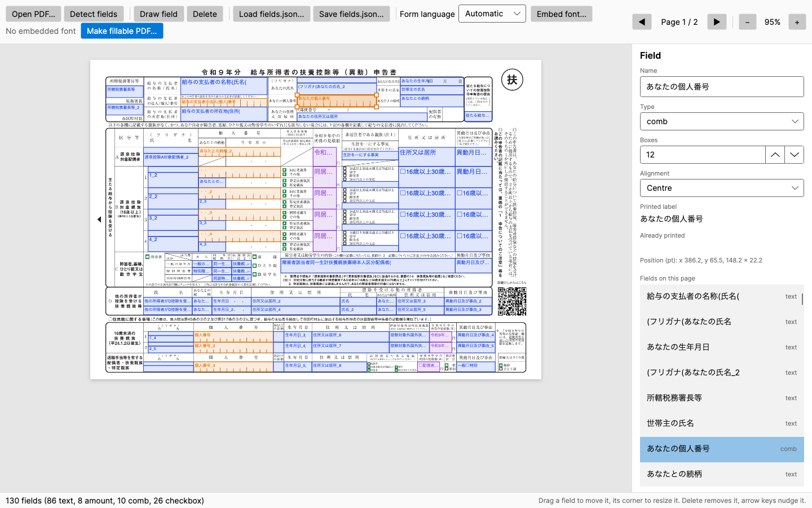

<p align="center">
  <picture>
    <source media="(prefers-color-scheme: dark)" srcset="assets/brand/wordmark-on-dark.svg">
    
  </picture>
</p>

# Washi 和紙

Open-source PDF toolkit for desktop, CLI and AI agents. It auto-detects form
fields, fills them, and can OCR, redact and merge PDFs. It has built-in AI
(Claude, GPT, DeepSeek or a local model) and an MCP server. Written in C# /
Avalonia.

> **Status: pre-alpha.** Working today:
>
> - `washi form make` turns a flat PDF into a fillable one
> - `washi-mcp` lets AI agents (Claude Desktop, Claude Code and other MCP clients)
>   read, render, detect, make fillable and fill PDFs, on its own or through the
>   desktop app's MCP server (Settings → AI & MCP)
>
> - the desktop editor (`Washi.App`) lets a person review and correct the
>   detected fields before the fillable PDF is written
> - the built-in AI (Claude, GPT, DeepSeek or a local model) names fields from the
>   page image, fills a form from your profile and answers questions about a PDF
> - `washi ocr` makes scanned pages searchable (Apple Vision on the Mac, Tesseract,
>   or an AI model), and `washi pdf merge|split` keeps form fields fillable
>
> - `washi pdf erase` and the editor's **Erase** tool remove text, images and marks that are
>   already printed on a page (wrong data on a form), for real, before you fill it again
>
> The Python reference
> implementation lives in [`prototype/`](prototype/).

## Why

Many PDF forms are "flat": printed tables with no fillable fields, sometimes
with prefilled data that is wrong. Making them fillable by hand means drawing
every field. Washi's **Masume** engine (マス目, the grid of boxes on a form)
finds the cells itself and suggests the fields. A person then reviews them.

Each 国税庁 年末調整 form below ships with fields made by hand. `washi masume
eval` ignores them, detects fields on the flat page, then compares:

| form | real fields | detected | recall (C#) | precision (C#) | Python prototype |
|---|---|---|---|---|---|
| 扶養控除等(異動)申告書 R9 | 193 | 130 | 78% | 100% | 78% / 100% |
| 保険料控除申告書 R8 | 143 | 135 | 84% | 87% | 84% / 90% |
| 基礎・配偶者・特定親族・所得金額調整 R8 | 83 | 78 | 83% | 88% | 83% / 90% |

- **Recall**: the share of hand-made fields whose centre is covered by a detected field.
- **Precision**: the share of detected fields that sit on a hand-made field.

On 保険料控除, C# and Python detect the same 135 fields: same
positions, same kinds. On the other two forms, PDFium's character boxes let the C# port find
a few more □ checkboxes. Each form takes 1–2 s. Method: [`prototype/README.md`](prototype/README.md).

## Making a form fillable

```bash
washi form make form.pdf -o form_fillable.pdf            # detect fields and write them
washi masume detect form.pdf -o out                      # or review first: out/form_fields.json
washi form make form.pdf --fields out/form_fields.json   # ...then write the reviewed fields
```

- **Field types**:
  - text
  - amount (right-aligned)
  - comb (`MaxLen`, one character per box, e.g. マイナンバー)
  - checkbox
  - radio button: ○ choices on one line (○有 ○無) become one group, of which one option is chosen;
    placeholders such as ○○県 or 令和○年 are left alone
  - drop-down list (set in the editor: type, then one item per line)
  - signature: a blank labelled 署名, Signature, 签名, 서명 … becomes an empty signature field
- **Rotated pages** are straightened first, so fields and typed text stay upright in every viewer.
- **Form language** (`--lang auto|ja|zh-Hans|zh-Hant|ko|en|fr|de`) picks the font that
  viewers use for typed text. Each script needs its own font: a Japanese font has no Hangul,
  and the two Chinese standards differ.

  | language | font requested |
  |---|---|
  | ja | KozMinPr6N |
  | zh-Hans | STSong |
  | zh-Hant | MSung |
  | ko | HYSMyeongJo |
  | en / fr / de | Helvetica |

  `auto` reads the page text. If the text is unreadable, it uses your system language.
- **Protected PDFs** (an owner password forbids changes) are refused. Washi does not remove protection.


### Fonts: referenced or embedded

**By default** fonts are referenced, not embedded, the way the 国税庁 forms do
it, so files stay small. The viewer draws typed text with a local font. In
viewers built on PDFium (Chrome, Edge), that means characters outside GB2312
disappear: 燁, 陳 and 臺 vanished in our tests.

**With `--embed-font`** the whole font goes into the PDF, and every text field
uses it:

```bash
washi form make form.pdf --embed-font NotoSansJP-Regular.ttf
washi form make form.pdf --embed-font "/System/Library/Fonts/ヒラギノ角ゴシック W3.ttc" --font-index 0
```

- **Formats**:
  - TrueType or CFF outlines (`.ttf`, `.otf`)
  - one face of a collection (`.ttc`, chosen with `--font-index`)
  - variable fonts are refused: use a static weight
- **Licence check**: Washi reads the font's OS/2 `fsType`. It only embeds fonts
  marked installable (0) or editable (8), because a fillable form is a document
  people edit. Restricted, preview-and-print and bitmap-only fonts are refused,
  with a message in the UI language.
- **Size**: the whole font is added (deflated), for example:

  | font | adds |
  |---|---|
  | AppleSDGothicNeo | 2.2 MB |
  | Hiragino Sans W3 | 5.9 MB |
  | Arial Unicode | 15 MB |

  Free OFL fonts that work well: Noto Sans JP / SC / TC / KR (static TTF or
  OTF) and BIZ UDGothic.
- **Tested**: we typed into generated forms through PDFium's own form-filling API
  (the code path Chrome uses). The text was 林 燁 陳大文 臺北市 홍길동, Éloïse
  Müller-Straße ç 张伟 and マイナンバー, and every character showed in the
  embedded font. The resource name that makes PDFium use the embedded font is
  explained in `AcroFormWriter.EmbeddedKey`.

## Desktop editor

`Washi.App` is the desktop app. Its layout follows Acrobat:
- a **tool rail** on the left: Form, OCR, Combine, Split, Organize, Compress, Comment, Sign, Protect, Redact, Edit text, Images, Headers, Links, Compare, Erase, AI assistant, and **Settings** at the
  bottom. Settings opens as a page in place of the document, not as a separate window
- the **tool's panel** next to the rail, with its main action always at the bottom.
  Click the active tool again to fold the panel away.
- the **page** in the middle, with floating edit tools and page and zoom controls
- **Fields**, **Pages** (thumbnails) and **Bookmarks** panels on the right



**Form tool**, the "human confirms" half of Masume:
1. **Open** a PDF (button, ⌘O, or drop it on the window). Masume suggests fields, coloured
   by type over the page:
   - blue: text
   - purple: amount
   - orange: comb
   - green: checkbox
   - teal: radio button (a ring)
   - blue with ▾: drop-down list
   - brown with ✍: signature
   - red dashed outline: the cell already has printed data

   The selected field is vermilion.
2. **Fix** the fields:
   - drag a field to move it, drag a corner to resize it
   - **V** selects, **F** draws a new field, **P** previews
   - **Tab** / **Shift+Tab** walks through the fields; **Enter** jumps to the name box
   - **Delete** removes the field; the arrow keys nudge it (Shift = 5 pt)
3. **Preview** (**P**, the third floating button) lets you try the form as a viewer
   would: click a field and type right on the page (comb fields put one character in
   each printed box), click a checkbox to tick it. Tab moves to the next field, Delete
   clears a value.
4. **Save** `fields.json`, or write the **fillable PDF** (⌘S), with a form language and
   an optional embedded font. Whatever you typed in Preview is filled in.

**The other tools:**
- **OCR** makes a scan searchable. It shows how many pages need it, and you pick the
  engine (Apple Vision, Tesseract or the AI model, which asks before sending pages) and
  the languages. The searchable result opens in the editor.
- **Combine** starts with the open file; add more files or drop them, then reorder them.
  Protected files are marked and are not combined.
- **Split** previews the files ("3 files: p1-3, p5, p6") before writing them to a folder.
- **Organize** shows the pages as a grid. Select one or more (⌘/Ctrl or Shift + click) to turn them left or right,
  move them, or remove them (Delete), and insert every page of other PDFs after the selection (button, or drop
  the files). **Save as new PDF** writes the result, keeps the form fields fillable, and opens it.
- **Comment**: highlight, underline or strike out text (drag over it), add sticky notes (type, then click) and text
  boxes (type, then drag), draw with a pen, or draw boxes. **Save with comments** writes a copy with standard PDF
  annotations, each with its own appearance, so every viewer shows them the same way (rotated pages included).
  Comments the file already has (from Acrobat, Preview or anyone else) are listed with their replies: click one, here
  or on the page, to change its words, give it another colour, remove it (with its replies) or reply to it, and drag
  a note, box, text box or pen drawing to move it. Washi redraws what it changes; comments of kinds it does not draw
  (circles, stamps…) can still be reworded, removed and answered. Agents use `list_comments` (which gives each
  comment's id) and `edit_comments`.
- **Sign** (Fill & Sign): sign once on the pad with a mouse, trackpad or pen. The signature is kept as vector strokes
  in `~/.config/washi/signature.txt` if you tick "Remember" (never sent anywhere; untick to delete it). Drag a box on
  the page, or press **Sign here** next to a signature field, for each place to sign. **Save signed copy** draws the
  signature into the page as smooth curves (it prints sharply and is part of the page, like Acrobat's Fill & Sign)
  and keeps the form fields. Signing is deliberately not offered to the AI assistant or MCP clients. The same tool
  signs with a **digital ID** (a certificate-based PAdES signature) and checks the signatures a file already has
  (see *Digital signatures*).
- **Protect**: shows how the open file is protected and what it does not allow. Add a password to open it and/or
  limits (printing, copying, changes, comments, filling in, page changes) guarded by a separate permissions password,
  with AES-256; remove protection with the password that allows it; and **remove hidden information** before sending
  a file (see below). A file that needs a password asks for it when it is opened; the password is kept in memory
  until Washi closes and never written anywhere. **Encrypt for certificates** instead of a password: only the people
  whose certificates you add (and you, with your digital ID) can open the copy; a file encrypted that way opens with a
  recipient's digital ID into a copy without the protection.
- **Document**: page labels (the numbers the viewer shows: i, ii, 1, 2, A-1 …), attached files (attach, save out,
  remove), layers (which show and print when the file opens) and form data (save the values to XFDF, FDF, CSV or
  JSON, fill from such a file, one filled copy per row of a table, many filled forms into one table). Each change
  saves a copy (see below).
- **Redact**: find words, phrases, e-mail addresses, phone numbers and long ID numbers (or drag over any area: a
  photo, a signature, a stamp), untick what should stay, then save a copy where what lies under each black box is
  removed from the file for real (see below).
- **Finalize**: flatten the form fields and comments into the page (a final version to submit), check the file
  against PDF/A-2b, and save a PDF/A copy for archiving, optionally flattened first (see below).
- **Edit text**: click a line on the page and type its new text, or find and replace; the changes show on the page
  and are saved to a copy, checked before it is kept (see below).
- **Headers**: header and footer texts (left, centre, right) with page numbers, the file name, the date and Bates
  numbers, and a see-through watermark; previewed on the page, saved to a copy (see below).
- **Images**: the images the pages draw, outlined; click one to replace it with a picture file or remove it; choose a
  picture and drag a box to add it; save a copy (see below).
- **Links**: the file's links outlined on the page; drag a box and type a web or mail address or a page number, or
  link every address written in the text; mark links to remove; save a copy (see below).
- **Compare**: the open file against another version of it; the differences are listed, shown on the page, and can
  be saved as a copy with each one marked as a comment (see below).
- **Ask AI** answers questions about the document, after showing what it will send.

**Find:** ⌘/Ctrl+F opens the find bar over the page, in every tool. It searches as you type, highlights every
hit on the page and steps through them with Enter and Shift+Enter (or ⌘/Ctrl+G, F3). Case, full-width and half-width
forms and spaces do not matter, so 山田太郎 finds 山田 太郎; *Aa* and *ab|* match case and whole words. Scanned pages need
OCR first. The same search is `washi pdf find <in.pdf> <text>` and the `search_text` MCP tool.

**Bookmarks:** the bookmark button in the right rail shows the document's outline; a click opens the bookmark's page
at its place. Add one for the page you are reading (it takes the page's first line as its title), rename it, remove
it, move it up or down, nest it under the one above or take it out of its parent, point it at another page, then save
a copy. Bookmarks you did not change keep their links, colour and style, and every copy is read back to check its
outline. On the command line, `washi pdf bookmarks in.pdf` lists them one per line (two spaces per level, a tab, the
page) and `--set outline.txt` writes a copy with the ones in such a file; agents use `list_bookmarks` and
`set_bookmarks`, for example to add a table of contents built from `extract_text`.

**Print:** the printer button in the header (⌘/Ctrl+P) opens a print card: printer, copies, all pages, the current
page or a list such as `1-3, 5`, two-sided, black and white, fit to the paper or actual size. It prints the file as it
is saved on disk. On macOS and Linux the job goes to CUPS (`lp`), which prints PDF as it is; on Windows each page is
rendered with PDFium at the printer's resolution and sent to the Windows print system. Files that do not allow
printing are refused, and so are files that need a password to open (save a copy without it in Protect first).
`washi pdf print in.pdf [--printer name] [--copies n] [--pages 1-3,5] [--two-sided] [--gray] [--actual-size]` and
`washi pdf printers` do the same from the command line. Printing is not offered to the AI assistant or MCP clients.

**Zoom:** pinch on a touch screen or trackpad, or ⌘/Ctrl + scroll. The point under your
fingers stays put. The page fits the width when opened, and keeps fitting as panels
open and close until you zoom by hand.

**Settings** (gear button, or Washi ▸ Settings… / ⌘, on macOS):
- the interface language: system, 日本語, 简体中文, 繁體中文, 한국어, English, Français or
  Deutsch. It is saved in `~/.config/washi/settings.json`, and the window reopens in
  that language. `WASHI_LANG` still overrides it.
- **About Washi**: the version, the AGPL licence with a link to the source code, and the
  open-source components with their licences ([`THIRD_PARTY_NOTICES.md`](THIRD_PARTY_NOTICES.md)).

The app uses a light theme only for now.

**macOS app:** `build/macos/bundle.sh` builds `build/out/Washi.app` with the Washi icon.
The app needs the .NET 10 runtime. It also offers itself in Finder's "Open With" for
PDFs, without becoming the default app. Run from `dotnet`, the editor still sets its
Dock icon itself.

**Tests.** The editor is tested headlessly with Avalonia's test platform and real
Skia rendering. The tests cover:
- opening a PDF; dragging, resizing and drawing fields; keyboard deletion and nudging
- the `fields.json` round trip and writing the PDF
- switching tools, field navigation, fit width and pinch zoom
- Preview: typing into fields, ticking boxes, and saving those values; lists that follow
  a language switch
- Combine (including protected files), Split, OCR with the AI engine (consent first)
  and Ask AI
- the language setting

Run `WASHI_SCREENSHOT_DIR=… dotnet test --project tests/Washi.App.Tests -- --filter-method "*Screenshot"`
to save screenshots for review.

## Built-in AI

```bash
washi ai config                                   # default: claude-opus-5-5 (Anthropic)
washi ai key anthropic                            # paste the key; stored in the macOS Keychain
washi ai config deepseek deepseek-flash           # or: openai <model> / local <model> --endpoint http://localhost:11434/v1 [--vision no]
washi ai models                                   # the provider's current model ids

washi ai name-fields form.pdf -o form_fields.json # Masume finds the boxes, the AI names them from the page image
washi form make form.pdf --fields form_fields.json
washi ai fill form_fillable.pdf --profile me.txt  # the AI decides what goes where; Washi writes and draws the values
washi ai ask contract.pdf "When does the contract end?"
```

- **Naming.** The AI sees the page image and the detected boxes in a 0–1000 grid. It returns a
  name, a type and a box count for each field. Made-up ids are ignored and names are made unique.
  This is what turns `p1_text_001` into `世帯主の氏名`, even when the PDF's text layer is garbled.
- **Filling.** The AI sees the fields (name, type, position, options) and the page images, plus
  the profile with long numbers masked. It returns values only where the profile holds the
  answer, and notes for the rest. Unknown fields and invalid options are dropped.
- **Asking.** A readable text layer goes as text. A scanned or garbled one goes as page images.
- **Claude** gets structured outputs, which force the JSON shape, and server-side refusal
  fallback. **DeepSeek** (`deepseek-flash`) and local servers get JSON mode. Page images are
  sent by default; for a text-only model, `washi ai config … --vision no` sends the page text
  instead. `washi ai models` lists the provider's current model ids.
- **Tested live** with `deepseek-flash` on the 国税庁 基礎控除 form: 78 fields on 2 pages in
  about 2.5 minutes, 59 renamed and 3 types corrected. Most names improved; for example,
  フリガナ and 氏名 rows were split and `所得金額_3` became `合計所得金額の見積額`. A few got
  worse, which is why the editor keeps the human review step.
- The editor's **Name fields with AI** button runs the same naming step, after a confirmation dialog.
- The model, endpoint and API key can also be set in the app: **Settings → AI model**
  (with *Test connection*, which lists the models and checks that tool calls work).

### The AI assistant (desktop app)

The **AI assistant** tool is a chat that works with the same tools as the MCP server
(`pdf_info`, `extract_text`, `render_page`, `fill_fields`, `merge_pdfs`, …) plus two that only the
app has: `get_open_document` and `open_document`. Ask about the open PDF, or have it make a form
fillable, fill it, merge or split files in your folders.

- **Streaming, tool calls in a loop.** The agent loop and the providers come from
  [MySSH](https://github.com/dollarkillerx/MySSH): Claude over its own HTTP + SSE client (adaptive
  thinking, refusal fallback, prompt caching, thinking blocks replayed as received), OpenAI, DeepSeek
  and local servers over the OpenAI SDK. Page images from `render_page` reach the model when it takes
  images.
- **Context.** The open document (path and page) rides along as a chip you can switch off. Context is
  data, never instructions: text inside a PDF cannot steer the assistant.
- **Data notice.** For a cloud provider the chat says once where messages and the documents the
  assistant reads will go, and waits for *Continue*. Keys, passwords and tokens in messages are masked.
- **Approvals inline.** A tool that writes a file shows a card in the chat (*Allow* / *Deny*); see
  *AI & MCP access* below.

## OCR: searchable scans

```bash
washi ocr scan.pdf                         # -> scan_ocr.pdf
washi ocr scan.pdf --lang ja,en --text scan.txt
washi ocr scan.pdf --engine ai --yes       # the configured AI model reads the page images
```

- **What it does**: pages without readable text (scans, or PDFs whose fonts have no Unicode
  mapping) are rendered at 300 dpi and recognised. Washi then adds an **invisible text
  layer**, so the page looks exactly the same but can be searched, selected and copied.
  Pages that already have text are skipped (`--force` recognises them too). Running it
  again on the output does nothing, since Washi marks the pages it has made searchable.
- **Engines**:
  - `vision` (default on macOS): Apple's Vision framework, on the device. A small Swift helper
    ships as source and is compiled once with the Xcode command line tools, then cached.
  - `tesseract`: the Tesseract CLI, on the device. Each language needs its traineddata
    (`brew install tesseract-lang`); missing languages are skipped and reported.
  - `ai`: the configured AI model reads the page images. It is good at handwriting, but its
    boxes are approximate. It asks before sending pages, like the other AI features.
- **The text layer**: every line uses text render mode 3 (invisible), stretched to the width
  the engine measured. The font is a tiny embedded TrueType font whose character codes are
  the UTF-16 values, so Japanese, Chinese, Korean and Latin text all copy correctly.
  Rotated pages (`/Rotate`) get the layer where the user sees the text.
- **Tested**: on an image-only scan of the 扶養控除 form, Vision found 205 lines in about 3 s
  per page (the name, the address and the 13-digit company number). Both PDFium and macOS PDFKit
  (Preview) find the text at the right spots.

## Merge, split and organize

```bash
washi pdf merge a.pdf b.pdf c.pdf -o all.pdf
washi pdf from-images receipt1.jpg receipt2.jpg scan.png -o receipts.pdf   # one page per image, A4
washi pdf split all.pdf --pages 1-2,5 -o parts     # parts/all_p1-2.pdf, parts/all_p5.pdf
washi pdf split all.pdf                            # one file per page
washi pdf organize all.pdf --pages 3,1-2 --rotate 3:90 -o new.pdf   # page 3 first and turned; pages 4+ dropped
washi pdf crop scan.pdf --trim                     # scan_cropped.pdf: the white paper around the content cut off
washi pdf crop slides.pdf --margins 20,30 --pages 2-9   # 20 pt off the top and bottom, 30 off the sides
washi pdf export-images report.pdf --dpi 300 --format jpeg   # report_images/report_p1.jpg, …
```

- **Form fields stay fillable**: the copied pages' fields are registered in the new file's
  AcroForm, with the fonts their appearances use. When two inputs have a field with the
  same name, the second gets `_2`, so filling one does not fill the other. Merging the three
  filled 年末調整 forms kept all 405 fields and their values.
- **Protected files**: if a file's permissions forbid reusing its pages (as the 国税庁 PDFs
  do), Washi refuses it. Washi does not remove protection without its password (see
  [Passwords and hidden information](#passwords-and-hidden-information)).
- `split` never overwrites existing parts.
- `organize` writes exactly the listed pages in that order, so pages left out are dropped. A turned
  page's form fields turn with it (`/MK /R`), so text typed later still reads upright. A page may
  appear only once, because two copies would share their fields' values.

## Passwords and hidden information

```bash
washi pdf protect form.pdf -o locked.pdf --open                    # asks for a password to open it
washi pdf protect form.pdf -o limited.pdf --allow print,fill       # opens freely; only printing and filling in allowed
washi pdf unlock locked.pdf -o open.pdf                            # asks for the password
washi pdf clean report.pdf --list                                  # what the file carries besides its pages
washi pdf clean report.pdf                                         # report_cleaned.pdf without it
washi pdf protect report.pdf --to sato.cer,me.cer                  # report_sealed.pdf: opens only with their digital IDs
washi pdf unlock report_sealed.pdf --id me.p12                     # report_sealed_opened.pdf, opened with mine
```

- **Passwords**: AES-256 (PDF 2.0; Acrobat X and every current viewer open it). Limits need their own permissions
  password, different from the one to open, or anyone who can open the file could lift them. Passwords are asked for
  at the terminal or read from `WASHI_OPEN_PASSWORD`, `WASHI_PERMISSIONS_PASSWORD` and `WASHI_PASSWORD`, never taken
  as arguments (those end up in the shell history). Every protected copy is opened again to check it asks for what
  it should.
- **Removing protection** needs the password that allows it: the permissions password, or the password to open when
  there is no separate one. Washi never removes protection without it, so files whose permissions forbid changes
  (as the 国税庁 PDFs do) are still refused by the other tools.
- **Hidden information**: document properties and XMP metadata, attached files, scripts and actions (JavaScript,
  actions that run on opening, launching programs, sending form data, XFA), comments, private program data
  (`/PieceInfo`, which can hold a whole editable copy) and thumbnails, and earlier versions that incremental saves
  leave in the file. The cleaned copy is checked again for every kind removed. Form fields, links and the pages
  themselves stay. Protection and hidden information are deliberately separate steps: clean first, then protect.
- **Certificate security** (Adobe.PubSec, adbe.pkcs7.s5, AES-256, PDF 32000-2 7.6.5): a random file key is wrapped
  for each recipient in a CMS envelope (RSA, AES-256), so no password is shared; this is what Acrobat's *certificate
  security* writes and reads. Recipients are given by their certificate alone (`.cer`, `.pem`); digital IDs that
  Washi makes are RSA 2048 for this (ECDSA keys cannot receive a key this way). Every string and stream of the copy is
  encrypted by Washi itself, and the copy is read back through the same key and compared object by object with the
  original before it is kept. To open one, Washi unwraps the key with the recipient's private key and writes a copy
  without the protection. Signed files are refused (encrypting would break the signatures). The copy is packed into
  object streams like Washi's other copies, so it is about the size of the original. Checked both ways with pyHanko
  (it opens what Washi encrypts, Washi opens what it encrypts) on the IRS W-9, Pub 15-T, the USCIS I-9 and a court
  form; all 21 unprotected public test documents encrypt and open again with the same text.
- Setting passwords and opening certificate-encrypted files are not offered to the AI assistant or MCP clients.
  `remove_hidden_info` and `encrypt_for_certificates` (which needs only the recipients' certificates) are.

## Form data

```bash
washi pdf data filled.pdf -o filled.xfdf                       # the values, as Acrobat imports them (.fdf, .csv, .json too)
washi pdf data form.pdf --import filled.xfdf                   # form_filled.pdf
washi pdf data form.pdf --rows staff.csv --name-column 社員番号   # form_filled/A001.pdf, A002.pdf … one per row
washi pdf collect form_filled/ -o summary.csv                  # many filled forms into one table
```

In the editor: **Document** in the tool rail, *Form data*. Agents use `export_form_data`, `import_form_data`,
`fill_form_from_table` and `collect_form_data`.

- **Formats**: FDF (PDF 32000 12.7.8) and XFDF (ISO 19444-1) with the fields as a tree of partial names and buttons by
  their state names, as Acrobat writes and reads them; CSV with a header row of field names (UTF-8 with a byte-order
  mark, so spreadsheets read Japanese; Shift_JIS from Japanese spreadsheets is read too); JSON as `fill_fields` takes it.
  Each file is read back before it is kept.
- **Importing** fills as Washi always fills: the form's formats, ranges and calculations apply and Washi draws each
  value. Names that are no field of the form are listed.
- **One copy per row**: empty cells leave their field as the form has it; a column can name each copy; existing files
  are never replaced.
- **Collecting**: a row per PDF, the file name first, a column per field in the order the fields first appear.
- Run on the public IRS 1040, W-4, W-8BEN and W-9 and the USCIS I-9: every value filled into them goes out through all
  four formats and back into the blank form unchanged.

## Page labels, attachments and layers

```bash
washi pdf labels book.pdf --set 1:i,5:1,120:A:付録-      # i–iv, then 1, 2, 3 …, then 付録-A, 付録-B …
washi pdf labels book.pdf                                # the labels, page by page
washi pdf attachments invoice.pdf --add 明細.csv,receipt.jpg --description 明細
washi pdf attachments invoice_attached.pdf --extract out/
washi pdf layers plan.pdf --show 電気 --hide 下書き
```

In the editor: **Document** in the tool rail. Agents use `list_page_labels`, `set_page_labels`, `list_attachments`,
`edit_attachments`, `extract_attachments`, `list_layers` and `set_layers`.

- **Page labels** are written as runs `page:style[:prefix[:first]]`: styles `1`, `I`, `i`, `A`, `a`, or `-` for a
  prefix alone (letters go on AA, BB … as PDF counts them). Pages before the first run keep their plain numbers.
- **Attachments**: files in the document's list of attachments and on file-attachment comments are listed and saved
  out; added files are compressed and carry their size, date and MD5 checksum, and each is read back byte for byte. A
  name from a PDF is reduced to a plain file name before it is saved (no folders, no `..`), and a file already there
  is never replaced. Removed files are gone from the copy, not only from the list.
- **Layers** (optional content): name, whether it shows, whether it is locked, and the pages that draw on it. A copy
  sets which show when the file opens; viewers, Washi's included, draw and print what that says.

## Redaction

```bash
washi pdf redact report.pdf --find "山田太郎" --find Yamada --list          # only show the matches
washi pdf redact report.pdf --find "山田太郎" --pattern email,phone,number   # report_redacted.pdf
washi pdf redact scan.pdf --box 1:400,60,560,120                             # an area: a photo, a stamp
```

In the editor: choose **Redact**, type the words (one per line) and tick the kinds of data to find, then *Find*.
Every match is listed with the text around it and shown as a black box on the page; untick what should stay, drag
over anything else that must go, then *Redact and save copy*. Agents use the `redact` tool (`dry_run` lists the
matches).

- **Removed, not covered.** A black box alone leaves the text under it in the file, where anyone can copy it.
  Washi takes it out: each glyph whose centre lies in a box is cut from its string and replaced by a kerning number
  of the same width, so the rest of the line stays exactly where it was. The widths come from the font (`/Widths`,
  `/W`, Type 3 font matrices, the metrics of the 14 standard fonts, embedded CMaps for codes of 1 to 4 bytes,
  vertical writing). When a width cannot be known (a predefined CJK CMap with proportional widths), the whole run
  goes, with the runs that follow it on the same line, and its place is covered too.
- **Images:** the pixels of an image that lie under a box are blanked in a copy of that image (a scan with an OCR
  text layer loses both the picture and the hidden text). JPEG, JPEG 2000, JBIG2 and CCITT images are decoded with
  PDFium, in memory, and written back losslessly, so a redacted scan can grow. An image entirely inside a box is
  dropped. The original image is not saved when nothing else uses it.
- **Everything else under a box goes too:** drawings that lie entirely inside it (the coordinates as well, so a
  drawn signature cannot be recovered), comments, links and form fields (with the field's value), and forms nested
  in the page, each use redacted in its own copy.
- **Outside the pages:** matched form-field values and comments are removed, and the same words are masked with ■
  in document properties, XMP metadata, bookmarks, tags (`/ActualText`, `/Alt`) and other strings in the file.
  Attachments are not searched: remove them with `washi pdf clean`.
- **Matching** ignores case (unless `--case`), full-width and half-width forms and spaces, so 山田太郎 also finds
  山田 太郎 and ＹＡＭＡＤＡ. `--whole-words` skips matches inside longer words; `--regex` takes a .NET regular
  expression. Patterns: e-mail addresses, phone numbers (9 digits or more, in groups), and numbers of 7 digits or
  more (My Number, account and card numbers). Scanned pages need OCR first so their text can be found.
- **Checked before it is kept.** The copy is searched again (nothing may be found where a box is), no character
  may be left under a box, and both versions are rendered (no pixel may change outside the boxes). Matches you
  unticked stay. If a check fails the copy is deleted, so you never get a half-redacted file.
- Files whose permissions forbid changes are refused (remove the protection with its password first).

## Editing page text

```bash
washi pdf replace-text invoice.pdf --find 2025 --with 2026                  # invoice_edited.pdf, every match
washi pdf replace-text invoice.pdf --find "1,200" --with "1,350" --page 1
washi pdf replace-text form.pdf --box 1:40,52,180,66 --with "令和9年分"       # the text inside a box
washi pdf replace-text letter.pdf --paragraph "office will move" --with "The office stays where it is."   # a whole paragraph
```

In the editor: choose **Edit text**. Each line of the page is outlined; click one, type, Enter keeps the change and
Esc leaves the line as it was. *Replace all* adds a change for every place the text appears. The changes show on
the page (the old text covered, the new one over it) until *Save as copy*. Agents use the `edit_text` tool.

- **In place.** The old characters are taken out of the page content (the rest of the line stays exactly where it
  was, as in redaction) and the new text is drawn at the same baseline, size, colour and angle, inside the same text
  run, so copying the page's text or searching it reads in order.
- **The document's font when it can.** The new text uses the font the old text used when that font has every
  character (found through its ToUnicode map, or its encoding when the font is complete). Otherwise a similar
  font draws it: Times or Helvetica for Latin text; for Japanese, Chinese and Korean a Mincho or Gothic font of
  this computer (Hiragino on macOS, Yu Gothic / MS Mincho / Meiryo on Windows, Noto CJK on Linux), embedded as a
  subset with only the characters drawn, so it looks the same in every viewer and the file grows by a few dozen
  kilobytes. When the computer has none that may be embedded, a standard CJK font the viewer supplies is named. The
  report says which. Kanji alone (社外秘) is set as Japanese unless a character is Chinese-only or the app speaks Chinese.
- **Spacing kept.** Text set with extra space between its characters gets the same spacing.
- **Paragraphs.** Switch the tool to *Paragraphs* (or use `--paragraph "words in it"`, `paragraph_containing` for
  agents): a paragraph is lines in one size, one under another at an even spacing, ending where a line stops short.
  Its new text is set again in the paragraph's width, font, size and spacing, the first line's indent kept: Latin
  text breaks between words, Japanese, Chinese and Korean between characters (、。」） never start a line, 「（ never end
  one); a line break in the new text starts a new line. Digits or marks in another font of the same size stay part of
  the paragraph (all of it is then set in the font most of it uses). It may grow into empty space below, never over
  anything. Underlines and markers under some of the words (a thin rule just below a line, a fill as tall as the
  line) move with their words to where they now are; if the words are gone, so is the line under them.
- **One line at a time, left to right.** A change covers part of one line; text that runs down the page (vertical
  writing, or a turned page whose text runs sideways) is refused. A longer text that would run into the next
  characters on the line is refused too: change the whole line instead. A shorter one leaves a gap.
- **Checked before it is kept.** Both versions are rendered (nothing may change outside the edited text) and the
  page's text is read back (the new text must be there, at the old size). If a check fails the copy is deleted.
- Files whose permissions forbid changes are refused (remove the protection with its password first). Scanned pages
  have no text to edit; Erase and a comment text box are the way there.

### Cropping, and pages as images

In the editor both are in **Organize**, for the selected pages (or all): *Crop pages* (margins in millimetres, or
*trim to the content*) and *Save pages as images* (PNG or JPEG, 72, 150 or 300 dpi, into a folder you pick). Agents
use `crop_pages` and `export_page_images`.

- **Cropping sets the pages' crop box**: what is outside is hidden, not removed (redact to remove it). Margins are
  on the page as shown, turned pages included. Trimming finds the content by rendering the page and keeps a little
  paper around it; blank pages are left as they are. Each cropped page is rendered and compared with the same part of
  the original before the copy is kept.
- **Images** are the pages as shown (form fields and comments drawn, turned pages upright), named `<name>_p<n>`.
  Each file is read back after it is written; nothing is written when any of the files is already there.

### Photos and scans into a PDF

`washi pdf from-images` (`--page a4|letter|image`, `--margin`, `--dpi`), the `images_to_pdf` tool, and in the editor
**Combine**: add or drop JPEG, PNG, WebP, BMP or GIF files next to PDFs (photos dropped on the window open Combine),
choose the page size, *Combine*. Each image becomes a page.

- **JPEG photos go in as they are**: the file's bytes become the page image, so nothing is lost and nothing grows.
  Other formats are stored losslessly, with their transparency; an all-grey image stays grey.
- **Upright**: a phone photo's EXIF orientation is applied (turned or mirrored as the camera meant), and A4 or
  Letter pages turn to suit each image. The image is as large as fits, centred.
- **Checked before it is kept**: every page is rendered and compared with its image on a 12 × 12 grid, which catches
  a page turned the wrong way or with inverted colours.
- HEIC photos (an iPhone's) are converted first with the system's own tool (sips on macOS; heif-convert from libheif
  on Linux, when installed); Windows needs them saved as JPEG. Run OCR afterwards to make scanned text searchable.

## Images on the page

```bash
washi pdf images report.pdf                                        # list: id, page, size in pixels, box
washi pdf images report.pdf --replace 1-1=new-logo.png             # report_images.pdf
washi pdf images report.pdf --add "2:300,40,560,200=photo.jpg" --remove 3-2
```

In the editor: **Images** outlines the images each page draws. Click one, then *Replace…* or *Remove*; *Add a
picture…* asks for a file, then drag the box it goes in. Agents use `list_page_images` and `edit_page_images`.

- **A replaced image keeps its own shape** inside the old one's place, centred, and stays where it was in the drawing
  order (text drawn over it stays over it). An added picture fits its box the same way, over the page.
- **Only the operators that draw those images change.** JPEG files go in as they are; other formats losslessly; a
  photo's EXIF orientation is applied.
- **Checked before it is kept**: both versions are rendered (nothing may change outside the images' places) and each
  new image must look like its file.
- Images inside forms (XObjects) and inline images are listed and edited too; a form drawn on several pages is
  copied for the page that changes, so the others stay as they were. Scanned pages are one image each: replacing or
  removing it replaces or removes the page's picture.

## Links

```bash
washi pdf links brochure.pdf                                   # list: id, page, target, box
washi pdf links brochure.pdf --find-addresses                  # brochure_links.pdf: every web and mail address in the text linked
washi pdf links brochure.pdf --add "1:40,700,200,716=https://example.com" --add "1:40,720,200,736=5" --remove 2-1
```

In the editor: **Links** shows the file's links on the page. Drag a box, type where it goes (`example.com`,
`name@example.com` or a page number) and press Enter; *Link the addresses in the text* finds them all; tick
*Remove* on a link to drop it. Agents use `list_links` and `edit_links` (which can also point a link elsewhere).

- A web address without a scheme gets `https://`, a mail address `mailto:`; a number is a page of the document.
- Links are drawn without a border, so the pages look exactly the same: the copy is rendered next to the original
  (no pixel may differ) and every new link is read back with its target before the copy is kept.
- Addresses that already have a link are left alone. Links of other kinds (named destinations, scripts, files) are
  listed and kept.

## Comparing versions

```bash
washi pdf compare contract_v1.pdf contract_v2.pdf                    # what changed, page by page
washi pdf compare contract_v1.pdf contract_v2.pdf -o v2_marked.pdf  # and v2 with each change marked as a comment
```

In the editor: **Compare**, *Choose the other version…*, *Compare*. Added text is shown green, changed yellow,
removed red, pictures and drawings purple; *Save marked copy* writes the newer version with a comment on each
difference (the old wording in it). Agents use `compare_pdfs`.

- **Pages are paired by their text**, so a page added or removed in the middle does not make everything after it
  differ. Versions of the same length pair page by page.
- **Words are compared**, not lines: “1,200” → “1,350” is one change. Each Japanese, Chinese or Korean character is a
  word. Full-width and half-width forms count as the same. Words removed at the end of a line and a line added after
  it are two changes, not one.
- **Pictures and drawings** are compared by rendering both pages: changes outside the text (a stamp, a logo, a line,
  a colour) are boxed. A page whose size changed is one change.
- Scanned pages have no text: only their pictures are compared (OCR both first to compare their words).

## Headers, footers and watermarks

```bash
washi pdf stamp report.pdf --footer "{page} / {pages}"                        # page numbers, bottom centre
washi pdf stamp report.pdf --header "株式会社和紙||{date}" --footer "|{page}|"  # left and right header, centred footer
washi pdf stamp evidence.pdf --footer "||{bates}" --bates ACME- --bates-start 1001   # ACME-001001, ACME-001002, …
washi pdf stamp draft.pdf --watermark "社外秘" --opacity 0.2 --pages 2-5
washi pdf stamp report_stamped.pdf --header "Final" --replace-existing     # the old header and footer go first
washi pdf stamp report_stamped.pdf --remove all                           # report_stamped_unstamped.pdf
```

A header or footer is `left|centre|right` (one part is centred, two are left and right). The texts may hold
`{page}`, `{pages}`, `{date}` (yyyy-MM-dd), `{file}` and `{bates}`. In the editor: **Headers** in the tool rail,
*Page numbers* and *Bates numbers* fill in the usual places, and the page shows what will be added. Agents use
`stamp_pages`.

- **The page is not touched.** The marks go in content streams of their own before and after the page's content,
  which stays byte for byte as it was, and are tagged as page artifacts so screen readers skip them.
- Pages turned with /Rotate get their header at the top as shown. Japanese, Chinese and Korean text get a Mincho or
  Gothic CJK font; Latin text Helvetica (or Times with `serif`).
- **Bates numbers** count the pages that are stamped, from the start number, with at least the given digits.
- **Watermarks** are centred and turned (45° unless told otherwise), as large as fits unless a size is given,
  see-through, over the content or behind it.
- **Checked before it is kept.** Both versions are rendered (nothing may change outside the marks) and the pages'
  text read back (every header, footer and watermark must be there). A long document is checked on a sample of
  its pages: the first, the last and some between.
- **Changing them later.** Washi finds the headers, footers, page numbers and watermarks in a file when they are
  tagged as page artifacts, as Washi, Acrobat and Word tag them: the Headers tool shows them, replaces them with new
  ones (headers and footers when new ones are given, the watermark when a new one is), or takes them out. Only those
  tagged blocks change; the copy is checked (none is left, the pages' text only lost characters, Washi's own texts
  are gone). Running heads drawn as ordinary text cannot be told apart and stay.
- Files whose permissions forbid changes are refused.

## Formats, ranges and calculations

A typed field can carry rules, set in its properties (Form tool) or in `fields.json`:

- **Format**: a number (decimals, a currency mark such as ¥), a percentage, a date (`yyyy/mm/dd`, `dd.mm.yyyy`, …) or
  a pattern (`999-9999` for a Japanese postal code: 9 a digit, A a letter).
- **Range**: the smallest and largest number accepted.
- **Calculated**: the sum, product, average, smallest or largest of other fields (a total).

They are written as the field actions Acrobat itself writes (`AFNumber_Format`, `AFDate_FormatEx`,
`AFSpecial_KeystrokeEx`, `AFRange_Validate`, `AFSimple_Calculate`, and the form's calculation order), so Acrobat,
Reader, Foxit and other full viewers format, check and add up as the user types. Washi applies the same rules itself:
in Preview a total is worked out as values are typed and a value that does not fit is outlined in red; when filling
(`fill_fields`, Make fillable), what people type is accepted the way they type it (`1,200`, `１２００円`,
`令和8年11月22日`, `1500001`), stored the way Acrobat stores it (numbers plain, `1200`) and shown formatted
(`¥1,200`, `150-0001`). A value that is not a number or a date, or is out of range, is not filled, and the note says
why. Forms made elsewhere keep working: the same AF calls are read from their fields, as on the USCIS I-9 (postal
codes, phone numbers) and the 国税庁 input forms (amounts). Other scripts are left as they are and not run. These
actions are JavaScript: *Remove hidden information* lists them under scripts.

## Digital signatures

```bash
washi pdf make-id --name "山田 太郎" --email taro@example.com -o taro.p12     # a self-signed digital ID
washi pdf sign contract.pdf --id taro.p12 --page 2 --box 380,640,560,700 --reason 承認
washi pdf sign form.pdf --id taro.p12 --certify forms --tsa http://timestamp.example --ltv   # certify, time-stamp, LTV
washi pdf ltv contract_signed.pdf --tsa http://timestamp.example              # validation data and a document time-stamp
washi pdf verify contract_signed.pdf [--trust company-ca.cer]                 # exit code 3 when a signature is broken
```

In the editor, the **Sign** tool checks the signatures a file already has and signs with a digital ID: one from this
computer's certificate store (the login keychain on macOS, the personal store on Windows), a `.p12` / `.pfx` file, or
one made there. Choose where it goes (invisible, an empty signature field, or a box drawn on the page), add a reason
and place, and the hand-drawn signature if you like, whether it certifies the document, and whether to add long-term
validation. **Add long-term validation** does the same for the signatures a file already has. Agents can check
signatures (`verify_signatures`) and add long-term validation (`add_ltv`), but not sign.

- **PAdES**: a CAdES detached signature (SHA-256) with the signing certificate bound into it (ESS
  signing-certificate-v2), the form Acrobat and EU validators expect. Optional RFC 3161 time-stamp from a service you
  name; only the signature's hash is sent to it.
- **Added, not rewritten**: the signature is an incremental update after the file's last byte (a cross-reference
  table or stream, like the file's own), so everything before it is untouched and earlier signatures stay valid.
  Every signed copy is verified before it is kept.
- **Certification** (DocMDP): the first signature can certify the document as its author's and say what may follow:
  no changes, filling in forms and signing, or also comments. Washi refuses to sign a document certified with no
  changes allowed, and only the first signature certifies.
- **Long-term validation** (PAdES B-LT and B-LTA): a Document Security Store added after the signatures, with every
  certificate of each signer's chain (and of the time-stamping authority's) and, for each, an OCSP answer or a
  revocation list from the services the certificates name (only certificate identifiers are sent). The signature can
  then be checked offline after the certificates expire or the services close. With a time-stamping service, a
  document time-stamp (ETSI.RFC3161) follows; adding one again every few years renews it. Missing intermediate
  certificates are fetched from the addresses the certificates give; the chain a `.p12` file carries goes into the
  signature.
- **Checking**: the bytes each signature covers, its value (CMS, or the time-stamp token of a document time-stamp),
  the signer's certificate chain against this computer's trusted roots and any you add with `--trust` (offline,
  nothing is sent, not even to fetch certificates), the time (from a time-stamp when there is one), the validation
  data in the file, and what each later revision changed. Each answer must be signed by the certificate's issuer (or
  its OCSP responder) and current at the signing time. A certificate revoked before the signature is shown to exist
  (by its time-stamp or a later document time-stamp) makes it invalid; revoked later, it stands.
- **What changed afterwards**: the objects of the signed revision that the file now holds differently, by kind:
  validation data, document time-stamps, signatures, form filling, document properties, comments, or other changes
  (page content, fields added, …). Validation data and time-stamps are always allowed, further signatures unless a
  certification forbids all changes, form filling and comments as a certification allows. Each signature is
  *valid*, *unverified* (intact, but the identity is not trusted, as with a self-signed ID), *changed* (intact, but
  revised in a way it does not allow) or *invalid* (the signed bytes were altered, or a certificate was revoked), and
  says whether it is *LTV* (the file holds all it needs to be checked long-term).
- Checked with pyHanko 0.38 (AdES validation, offline, with only what the file holds): long-term validation with and
  without a document time-stamp, a certification followed by a second signature and form filling (valid), and a
  comment added under a certification that allows only form filling (rejected), as Washi judges them. A document
  time-stamp from a public time-stamping service, with its real OCSP answers, validates the same way.
- A self-signed ID proves the document did not change; for signatures that carry legal weight, use an ID from a
  certification authority. Password-protected files cannot be signed by Washi (remove the password first).

## Compression

```bash
washi pdf compress scan.pdf                    # scan_compressed.pdf, standard level
washi pdf compress report.pdf --level strong   # for e-mail size limits
```

In the editor: **Compress** in the tool rail, pick a level, *Compress and save copy*. Agents use `compress_pdf`.

- **Light** cleans up without losing anything and only scales down images far more detailed than needed (above
  300 dpi, to 200). **Standard** scales images above 225 dpi to 150 and stores photos as JPEG (quality 75): sharp on
  screen and in print. **Strong** goes to 100 dpi and quality 60, for e-mail limits.
- The resolution is measured where each image is shown (its size on the page), not from the image alone. Line art,
  charts and screenshots (few colours) stay lossless, as do one-bit scans and CMYK, spot-colour and indexed images.
  A new image is kept only when it is clearly smaller.
- Lossless savings for every file: streams compressed (or compressed better), identical images, fonts and profiles
  stored once (a logo on every page, a font embedded twice), page thumbnails dropped, earlier versions removed, and
  the small objects packed into compressed object streams with a cross-reference stream (PDF 1.5): forms with
  thousands of fields shrink by a quarter or more.
- **Checked before it is kept:** every page of the copy is rendered next to the original and compared. Form fields,
  links, bookmarks and text are not touched. Password-protected files are refused (the save would drop the
  protection), and a signed file is flagged: its signatures do not hold for the copy.
- Run over the public forms and documents Washi is tested with: IRS Pub 15-T 2.4 MB → 1.7 MB, Form 1040 −27%, a
  法務省 form −18%; a scan-style test document (photos at 436 dpi) loses over 60% at the standard level.

## Flattening and PDF/A

```bash
washi pdf flatten filled.pdf                       # fields and comments become part of the page → filled_flattened.pdf
washi pdf flatten review.pdf --comments-only       # only the comments; the form stays fillable
washi pdf pdfa report.pdf --check                  # what stands between the file and PDF/A-2b (exit code 4 when something does)
washi pdf pdfa filled.pdf --flatten                # a PDF/A-2b copy, flattened first → filled_pdfa.pdf
```

In the editor: **Finalize** in the tool rail. Agents use `flatten_pdf` and `convert_to_pdfa` (`check_only` lists).

**Flattening** draws each field's and comment's own appearance (what a viewer shows for it now) into the page where it
was, then takes the field or comment away: the page looks the same in every viewer and can no longer be changed in a
form or comment tool. Links stay. A value the file left the viewer to draw (`NeedAppearances`, or no appearance of its
own) is drawn by Washi first; a box with no look for its state draws nothing, as Acrobat shows it. Every page of the
copy is rendered next to the original and must match (inside a field, where PDFium's form layer smooths text its own
way, the ink must be in the same place), and the values Washi drew must read back. Signed files are refused:
flattening would break the signatures.

**PDF/A-2b** (ISO 19005-2, level B) keeps everything a page needs inside the file, so it looks the same in years to
come. The copy gets:

- **Every font embedded.** A font the file only names (Helvetica, Times, MS-Mincho, KozMin…) is replaced by a subset
  of a font of this computer with the same characters: Arial, Times New Roman or Courier New for the standard fonts
  (Liberation on Linux), Zapf Dingbats and Symbol for theirs, Hiragino (or Yu, MS and Noto CJK fonts) for Japanese,
  Chinese and Korean. Every string drawn in it is written again in the new font's codes, and where a new glyph is wider
  or narrower than the old width the string moves the pen back by the difference, so **every character stays exactly
  where it was**; only the glyph shapes are the computer's. The characters come from the font's ToUnicode map, its
  encoding's glyph names, or its CMap's encoding (Unicode, Shift-JIS, EUC, GBK, Big5, UHC).
- **Colour tied to a profile:** an sRGB output intent, or this computer's CMYK printer profile for a file that paints
  in CMYK (its RGB then goes through sRGB).
- **Nothing that runs or points outside:** JavaScript, actions (on opening, on events, in fields: Washi's field
  formats and calculations too), attached files, XFA, external content, LZW compression, transfer functions.
- **Comments and fields that carry their own appearance**, set to print; hidden ones (which show nothing) are taken
  out. Fields stay fillable unless the copy is flattened first.
- **XMP metadata** that says PDF/A-2b and repeats the document properties exactly (written as an incremental update,
  since PDFsharp writes its own XMP on every save), and small objects packed into object streams again.

The copy is checked against the rules again, every page (a sample of a long document) is rendered next to the
original, and its text is read back character by character in the same places, before it is kept. Washi's check
covers the rules above; it is not a full validator. The copies Washi makes of the public documents below, of the tests'
files and of real filled-in forms all pass [veraPDF](https://verapdf.org) 1.30 as PDF/A-2b. Along the way a copy also
drops Adobe Reader's usage rights (a signature that no longer holds once the file changes) and the glyph lists
(CIDSet, CharSet) other programs wrote for their embedded fonts, which PDF/A-2 does not need and which must otherwise be
exact. Signed files are refused. A font that cannot be
replaced (no character known for its codes, vertical writing, no font on this computer with its characters) stops the
conversion with its name. Run over the public documents Washi is tested with, all 21 that are not protected convert
(Form 1040, W-4, W-9 and W-8BEN with Zapf Dingbats check marks, the I-9 with Times and Helvetica only named, Pub 15-T
in CMYK, the 法務省, 出入国在留管理庁, 厚生労働省 and 裁判所 forms).

## Erasing printed text

Forms sometimes arrive with data already printed on them, and some of it is wrong. Making the form
fillable only adds fields on top, so new text lands over the old. **Erase** removes the old text first:

```bash
washi pdf erase form.pdf --box 1:183,44,336,76 --box 1:390,44,531,76   # page:x0,y0,x1,y1 in points, top-left origin
```

In the editor: choose **Erase**, drag boxes over the printed values (what will go turns red,
what stays is outlined in amber), then *Erase and save a copy*. Agents use the `erase_content`
tool; a field's `rect` from `list_fields` / `detect_fields` is a good box.

- **Removed, not covered.** The text, image and drawing operators are cut out of the page's content
  stream; image streams nothing uses any more are dropped from the file; the old content stream is
  not saved. Nothing is painted over with white.
- **Nothing else moves.** Only the operators that draw the erased objects change; every other
  byte of the page content is copied as it was. PDFium picks the objects (position and ink), and
  each one is matched to its operator with a type-by-type check, or the page is left alone.
- **Checked before it is kept.** Washi extracts the text again (no characters may remain where
  text was erased) and renders both versions (no pixel may change outside the boxes). If the
  check fails, the copy is deleted.
- **The form stays.** Official forms print the template in colour and the data in black, so by
  default only black and grey ink is erased (`--all-ink` to erase everything). Thin long lines
  (table rules, comb dividers) stay unless `--rules`.
- **Kept and said so:** a text line that runs outside the box, a text run joined to the next one
  on its line (erasing it alone would shift the rest), and big images such as a scanned page
  (their pixels are not edited).
- **Make printed text editable** (Form tool, or the button under *Already printed* for one field):
  the print under the fields is erased into `<name>_erased.pdf` and its text becomes each field's
  value, read from the PDF or, when its text layer is garbled, by on-device OCR of just the erased
  ink. Values you already typed are kept. Only text and images are moved here: on a black-printed
  form the boxes of a comb are drawings too, and they are the form. In the Erase tool, *put an
  editable field in each box* does the same for boxes you draw.
- **Generality.** Run over 53 PDFs: 国税庁, IRS, USCIS and CRA forms, two LaTeX papers, a 71-page
  IRS publication, Chrome and Quartz output, and 31 pdf.js test files (inline images, Type 3 fonts,
  clips, shadings, vertical and Arabic text, scans). 52 matched on every page and no run crashed;
  every erased copy passed the pixel check. What is refused, by design: files whose permissions
  forbid changes (the blank 国税庁 forms are protected that way), a page PDFium cannot parse, and
  text used as a clipping path (it is kept).
- Tested on a 扶養控除等申告書 whose printed data mixes text, ~770 glyph images and black strokes:
  the payer, name, furigana, numbers and addresses were removed (37 objects, 22 image streams
  dropped), with 0 characters left and 0 pixels changed outside the boxes.

## MCP server: PDFs for AI agents

There are two ways to run it:

- **In the desktop app** (Settings → AI & MCP → MCP server): Streamable HTTP on `127.0.0.1` with a
  bearer token, plus a local socket for `washi-mcp --app`, the stdio bridge for Claude Desktop. Agents
  then use the folders set in Settings, see the document open in the window (`get_open_document`,
  `open_document`), and every write waits for your approval as a card over the page. The page shows
  the exact `claude mcp add …` command and the `claude_desktop_config.json` snippet to copy, and the
  clients that connected.
- **Standalone** (`washi-mcp --allow <folder>`): stdio, no window, as below.

`washi-mcp` speaks the [Model Context Protocol](https://modelcontextprotocol.io).

| tool | does | changes files |
|---|---|---|
| `pdf_info` | pages, sizes, rotation, encryption, existing fields, text language | no |
| `extract_text` | text page by page (flags garbled text layers) | no |
| `search_text` | where a word or phrase is: page, text around it, boxes (case, width and spaces ignored) | no |
| `list_bookmarks` | the bookmarks (outline) as a tree: title, page, position, children | no |
| `set_bookmarks` | new PDF whose bookmarks are the tree given; unchanged ones keep their links and style | writes a **new** file |
| `render_page` | one page as PNG, filled fields included | no |
| `list_fields` | existing fields: name, type, value, page, rect, options | no |
| `detect_fields` | Masume field suggestions as fields.json, optional review image | no |
| `make_fillable` | new fillable PDF from a flat one (`lang`, `embed_font`, or reviewed `fields`) | writes a **new** file |
| `fill_fields` | new PDF with values filled in. Washi draws each value itself, so it looks the same everywhere | writes a **new** file |
| `merge_pdfs` | new PDF with the pages of several PDFs; form fields kept | writes a **new** file |
| `split_pdf` | new PDFs, one per page range | writes **new** files |
| `organize_pages` | new PDF with the listed pages in order: reorder, drop, rotate, insert pages from other PDFs; form fields kept | writes a **new** file |
| `list_comments` | review comments already in the PDF: type, page, rect, text, author | no |
| `add_comments` | new PDF with highlights, underlines, strike-outs, notes, text boxes, pen marks or boxes | writes a **new** file |
| `edit_comments` | new PDF with existing comments reworded, recoloured, moved, removed (with replies) or answered, by id | writes a **new** file |
| `remove_hidden_info` | list (`dry_run`) or remove metadata, attachments, scripts and actions, comments, private data and earlier versions | writes a **new** file |
| `redact` | find words, e-mail addresses, phone and ID numbers (`dry_run` lists them), then remove them and any `areas` for real under black boxes, checked afterwards | writes a **new** file |
| `edit_text` | new PDF with page text changed: find and replace, or the text inside a rect, in the document's font when it has the characters; one line at a time, checked afterwards | writes a **new** file |
| `list_page_images` | the images the pages draw: id, page, rect, size in pixels | no |
| `edit_page_images` | new PDF with images added in a rect, replaced (keeping their shape in the old place) or removed, checked afterwards | writes a **new** file |
| `list_links` | the links in a PDF: id, page, rect, web/mail address or page number | no |
| `edit_links` | new PDF with links added (over a rect, or every address in the text), pointed elsewhere or removed; pages unchanged, checked afterwards | writes a **new** file |
| `compare_pdfs` | the differences between two versions: page pairs, words changed, added and removed, pages added and removed, changes outside the text, with their boxes | no |
| `crop_pages` | new PDF with margins cut off the pages or the pages trimmed to their content (the crop box), checked afterwards | writes a **new** file |
| `export_page_images` | the pages as PNG or JPEG files at a resolution, in a folder, each read back | writes **new** files |
| `images_to_pdf` | new PDF from photos and scans, one page per image: JPEG as it is, others lossless, EXIF orientation applied, each page compared with its image | writes a **new** file |
| `stamp_pages` | new PDF with headers, footers, page and Bates numbers and/or a watermark, the page's own content untouched, checked afterwards | writes a **new** file |
| `compress_pdf` | new, smaller PDF (light / standard / strong): images scaled to where they are shown, streams compressed, duplicates kept once, object streams; pages compared before it is kept | writes a **new** file |
| `flatten_pdf` | new PDF with form fields and/or comments drawn into the page (no longer editable), pages compared before it is kept | writes a **new** file |
| `convert_to_pdfa` | what stands between a PDF and PDF/A-2b (`check_only`), or a new PDF/A-2b copy: fonts embedded with every character in place, sRGB/CMYK output intent, no scripts or attachments, XMP; checked again before it is kept | writes a **new** file |
| `verify_signatures` | the digital signatures in a PDF: kind (approval, certification, time-stamp), signer, time, intact, trusted, LTV, revoked, what changed afterwards and whether it is allowed, status | no |
| `export_form_data` | a form's values to a new FDF, XFDF, CSV or JSON file | writes a **new** file |
| `import_form_data` | new PDF filled from an FDF, XFDF, CSV or JSON file | writes a **new** file |
| `fill_form_from_table` | one filled copy of a form per row of a CSV, into a folder | writes files |
| `collect_form_data` | many filled forms into one new CSV table | writes a **new** file |
| `list_attachments` | the files attached to a PDF: name, size, description, date, page of a file-attachment comment | no |
| `edit_attachments` | new PDF with files attached and/or attachments removed | writes a **new** file |
| `extract_attachments` | the attached files saved into a folder (never over a file that is there) | writes files |
| `list_page_labels` | the page labels (runs and every page's label) | no |
| `set_page_labels` | new PDF with page labels set, or removed | writes a **new** file |
| `list_layers` | the layers: name, shown or not, locked, pages | no |
| `set_layers` | new PDF with chosen layers shown or hidden when it opens | writes a **new** file |
| `encrypt_for_certificates` | new PDF that only the holders of the given certificates can open (AES-256) | writes a **new** file |
| `add_ltv` | new PDF with long-term validation data for its signatures (fetched online from the certificates' OCSP and CRL services) and optionally a document time-stamp | writes a **new** file |
| `ocr_pdf` | on-device OCR (Vision or Tesseract): new searchable PDF plus the recognised text. The `ai` engine is not offered here, because the agent already is a model | writes a **new** file |
| `erase_content` | new PDF with the printed text, images and drawings inside boxes removed for real, checked afterwards | writes a **new** file |

**Safety:**
- **Folders:** the server only touches files inside the folders you pass with
  `--allow` (or `WASHI_ALLOWED_DIRS`). Symlinks are resolved first, so they
  cannot lead outside. Fonts may also be read from the system font folders.
- **Never overwrites:** the write tools create new files only; an existing
  output path is refused.
- **Tool hints:** every tool is tagged with `readOnlyHint` / `destructiveHint`,
  so clients can ask before writing.

```bash
dotnet publish src/Washi.Mcp -c Release -o ~/.local/share/washi
```

Claude Code:

```bash
claude mcp add washi -- dotnet ~/.local/share/washi/washi-mcp.dll --allow ~/Documents/forms
```

Claude Desktop (`claude_desktop_config.json`), and most other MCP clients use the same shape:

```json
{
  "mcpServers": {
    "washi": {
      "command": "dotnet",
      "args": ["/Users/you/.local/share/washi/washi-mcp.dll", "--allow", "/Users/you/Documents/forms"]
    }
  }
}
```

With the desktop app instead (MCP server on), the Settings page shows these snippets with the right paths:

```bash
claude mcp add --transport http washi http://127.0.0.1:PORT/mcp --header "Authorization: Bearer TOKEN"
```

```json
{ "mcpServers": { "washi": { "command": "/Applications/Washi.app/Contents/MacOS/mcp/washi-mcp", "args": ["--app"] } } }
```

`washi-mcp --app` starts Washi in the background when it is not running (macOS app bundle) and exits
with code 3 when the app's MCP server is off.

Then ask, for example: *"Make ~/Documents/forms/application.pdf fillable and fill in my name 林燁"*.
The agent calls `pdf_info` → `make_fillable` → `list_fields` → `fill_fields` → `render_page` to check.

### AI & MCP access (desktop app)

Settings → AI & MCP decides what the assistant and MCP clients may touch; both go through one tool
layer (`ToolInvoker`: folder policy → approval → run → log):

- **Folders.** Only the folders listed there, plus the open document's folder if you keep that box
  ticked. Paths are resolved (symlinks included) before the check.
- **Writing files:** *Ask me each time* (default), *Allow without asking*, or *Read only*. Write
  tools still create new files only. An approval nobody answers is declined after 2 minutes, and the
  agent is told not to retry in a loop.
- **No pop-up windows:** approvals are cards, in the chat for the assistant and over the page for MCP.
- **Log:** one line per call in `~/.config/washi/tool-calls.jsonl` (tool, caller, decision, time;
  no argument values).
- **Token** in the Keychain; *New token* locks out every HTTP client at once.

## Languages

The interface speaks English, 日本語, 简体中文, 繁體中文, 한국어, Français and Deutsch. It
follows your system language. Set `WASHI_LANG` (e.g. `ja`, `zh-Hant`, `de`) to change it.
Strings live in [`src/Washi.Core/Localization/strings.py`](src/Washi.Core/Localization/strings.py),
which generates the `.resx` files. A test checks that every language has every string
with the same placeholders.

## Architecture

Every PDF operation is defined **once**, as a tool in `Washi.Tools`. The CLI,
the built-in AI and the MCP server all call the same tools.

```
Washi.App (Avalonia) ── Washi.McpHost (in-app MCP: HTTP + local socket) ◄── washi-mcp --app
        │                         Washi.Cli    Washi.Mcp (washi-mcp: stdio, standalone or bridge)
        │                             │               │
        └─────────── Washi.Ai (model providers, assistant agent loop, consent)
                            │
                     Washi.Tools  (registry: name + JSON schema + risk level; ToolInvoker: folders,
                                   approvals, log — shared by the assistant and MCP)
                            │
        Washi.Core (PDF I/O, geometry)    Washi.Masume (form-field detection)
```

| project | role |
|---|---|
| `Washi.Core` | Reading and rendering PDFs (PDFium via PDFiumCore), writing AcroForms (PDFsharp 6.2, MIT), UI strings in 7 languages. Shared geometry (`PdfRect`, top-down points on the upright page), page snapshots, a small PNG writer. `Pages` (merge and split that keep forms; `PdfEraser` and a byte-range content-stream tokenizer; `PdfRedactor`, its content interpreter and font metrics; `PdfTextEditor`; `PdfStamper`; `PdfFromImages`; `PdfComparer`; `PdfPageImages`; `PdfLinks`; `PdfPageImageEdit`; `PdfSecurity`, `PdfCleaner`), `Ocr` (engines, the invisible text layer and its glyphless font) |
| `Washi.Masume` | form-field detection. `fields.json` has the same shape as the prototype's output |
| `Washi.Tools` | the 47 PDF tools, `ToolRegistry`, `PathPolicy` (allowed folders). Each tool has a `ToolRisk` level: `ReadOnly`, `Write` (new file) or `Destructive` (cannot be undone) |
| `Washi.Ai` | a thin `IAiModel` (instructions + text + page images + optional JSON schema → answer), so each provider keeps its own features:<br>• **Claude** through the official Anthropic C# SDK: structured outputs, server-side refusal fallback<br>• **GPT** through the official OpenAI SDK: strict JSON schema<br>• **DeepSeek** and **local models** (e.g. Ollama) through OpenAI-compatible endpoints: JSON mode<br>Plus the AI features, `SecretMasker` and settings/keys |
| `Washi.Mcp` | `washi-mcp`: the standalone MCP server over the tool registry (official C# MCP SDK, stdio), or with `--app` a byte pump to the desktop app's local socket |
| `Washi.McpHost` | the desktop app's MCP server (ported from MySSH): Streamable HTTP on loopback (stateless, bearer token, Origin/Host checks) and a Unix socket / named pipe (owner-only, peer uid checked); client list and disconnect |
| `Washi.Cli` | `washi` command line |
| `Washi.App` | Avalonia desktop app: field review editor (MVVM with CommunityToolkit.Mvvm; one `FieldCanvas` control draws the page and all fields), the AI assistant chat, the Settings page (AI model, AI & MCP access, MCP server), approvals |

### Privacy rules (by design)

- **Consent first.** Before anything goes to a cloud model, Washi says what will be sent (page
  images, field descriptions, profile lines, masked numbers) and waits for yes. In the CLI that
  is a prompt or `--yes`; in the editor it is a dialog.
- **Long numbers never leave the machine.** In a profile, マイナンバー, account, card and phone
  numbers (8 or more digits; dates are kept) become `{{SECRET_n}}` placeholders. The model only
  learns "a 12-digit number". The real digits are put back locally, and the CLI prints them as ••••.
- **Local models stay local.** With an OpenAI-compatible endpoint on loopback (e.g. Ollama),
  nothing leaves the machine and nothing is asked.
- **API keys** come from the environment or the macOS Keychain (`washi ai key …`), never
  from the settings file. Windows and Linux use environment variables for now.
- `Write` and `Destructive` tools need the user's confirmation when the AI calls them (unless the
  user chose *Allow without asking*; `Destructive` always asks).
- The MCP server writes copies by default, and only inside folders the user allows.
- The in-app MCP server is off by default and listens on loopback only.

## Build

Requires the .NET 10 SDK.

```bash
dotnet build Washi.slnx
dotnet test --solution Washi.slnx        # Microsoft.Testing.Platform (see global.json)
dotnet run --project src/Washi.Cli -- --version
dotnet run --project src/Washi.Cli -- masume detect form.pdf -o out   # fields.json + overlay PNGs
dotnet run --project src/Washi.Cli -- masume eval form.pdf -o out     # score against existing fields
dotnet run --project src/Washi.Cli -- ocr scan.pdf                    # searchable PDF (macOS: needs the Xcode command line tools)
dotnet run --project src/Washi.App -- form.pdf
build/macos/bundle.sh && open build/out/Washi.app                     # the macOS app
```

## Roadmap

1. ~~Port Masume to C# (PDFium render + text layer, managed connected components) and reach the prototype's scores.~~ Done.
2. ~~Write the AcroForm output (text, amount, comb, checkbox; fonts per language; rotated pages).~~ Done.
3. ~~Tools: `pdf_info`, `extract_text`, `render_page`, `list_fields`, `detect_fields`, `make_fillable`, `fill_fields`.~~ Done.
4. ~~MCP server over the tool registry (stdio).~~ Done. ~~Streamable HTTP and the in-app server.~~ Done.
5. ~~Avalonia field review editor.~~ Done.
6. ~~Built-in AI: name and type fields from the page image, fill from a profile, ask about a document.~~ Done. ~~AI assistant with tool calls.~~ Done.
7. ~~OCR (Apple Vision, Tesseract, AI), merge and split.~~ Done.
8. ~~Erase printed content: remove text, images and vector paths under a region for real (not just cover them), then verify by extracting text.~~ Done (`washi pdf erase`, the Erase tool, `erase_content`).
9. ~~Passwords and permissions; remove hidden information.~~ Done (`washi pdf protect|unlock|clean`, the Protect tool, `remove_hidden_info`).
10. ~~Redaction by keyword, pattern and area.~~ Done (`washi pdf redact`, the Redact tool, `redact`).
11. ~~Find in the document.~~ Done (the find bar, `washi pdf find`, `search_text`).
12. ~~Bookmarks: read, navigate, edit.~~ Done (the Bookmarks panel, `washi pdf bookmarks`, `list_bookmarks`, `set_bookmarks`).
13. ~~Print.~~ Done (the print card, `washi pdf print`).
14. ~~Formats, ranges and calculations in forms.~~ Done (field rules, written as Acrobat's field actions and applied when filling).
15. ~~Edit existing comments.~~ Done (the Comment tool, `edit_comments`).
16. ~~Compression.~~ Done (`washi pdf compress`, the Compress tool, `compress_pdf`).
17. ~~Digital signatures (PAdES) and their checking.~~ Done (`washi pdf sign|verify|make-id`, the Sign tool, `verify_signatures`).
18. ~~Editing page text: a line at a time, and find and replace.~~ Done (`washi pdf replace-text`, the Edit text tool, `edit_text`).
19. ~~Headers, footers, page and Bates numbers, watermarks.~~ Done (`washi pdf stamp`, the Headers tool, `stamp_pages`).
20. ~~Images to PDF.~~ Done (`washi pdf from-images`, Combine, `images_to_pdf`).
21. ~~Comparing versions.~~ Done (`washi pdf compare`, the Compare tool, `compare_pdfs`).
22. ~~Pages as images; cropping.~~ Done (`washi pdf export-images|crop`, Organize, `export_page_images`, `crop_pages`).
23. ~~Links.~~ Done (`washi pdf links`, the Links tool, `list_links`, `edit_links`).
24. ~~Images on the page.~~ Done (`washi pdf images`, the Images tool, `list_page_images`, `edit_page_images`).
25. ~~Updating and removing headers, footers and watermarks.~~ Done (`--replace-existing`, `--remove`, the Headers tool, `stamp_pages`).
26. ~~Editing a paragraph that reflows over several lines.~~ Done (Paragraphs in the Edit text tool, `--paragraph`, `paragraph_containing`).
27. ~~Flattening form fields and comments.~~ Done (`washi pdf flatten`, the Finalize tool, `flatten_pdf`).
28. ~~PDF/A-2b: checking and converting, with fonts that are only named replaced in place.~~ Done (`washi pdf pdfa`, the Finalize tool, `convert_to_pdfa`).
29. ~~Long-term validation (PAdES B-LT, B-LTA) and certification signatures.~~ Done (`washi pdf ltv`, `sign --certify --ltv`, the Sign tool, `add_ltv`).
30. ~~Page labels, attachments, layers, certificate security.~~ Done (`washi pdf labels|attachments|layers`, `protect --to`, `unlock --id`, the Document and Protect tools, eight MCP tools).
31. ~~Form data: FDF, XFDF, CSV and JSON out and in, a copy per row, many forms into one table.~~ Done (`washi pdf data|collect`, the Document tool, four MCP tools).

## License

Washi is licensed under the **GNU Affero General Public License v3.0 or later**
([`LICENSE`](LICENSE)).

You may use, modify and redistribute it. Anyone who distributes a modified
version, **or runs one as a network service** (for example a hosted MCP server
or a web API), must publish the complete corresponding source under the same
licence.

Dependencies under MIT, BSD and Apache-2.0 (Avalonia, PDFium, PdfPig,
OpenCvSharp, the Anthropic, OpenAI and MCP SDKs) are compatible with this
licence. AGPL engines such as MuPDF can be used too.

PDFsharp is pinned to **6.2.4, the last MIT release**. Version 6.5 is dual
licensed (AGPL-3.0-only or commercial) and must be activated in code. Moving to
6.5 is a one-line change, but it would make a future commercial licence of
Washi depend on a PDFsharp licence as well.

The brand assets in [`assets/brand/`](assets/brand/) are part of this repository. Their lettering
is outlined from IBM Plex (SIL Open Font License 1.1).
